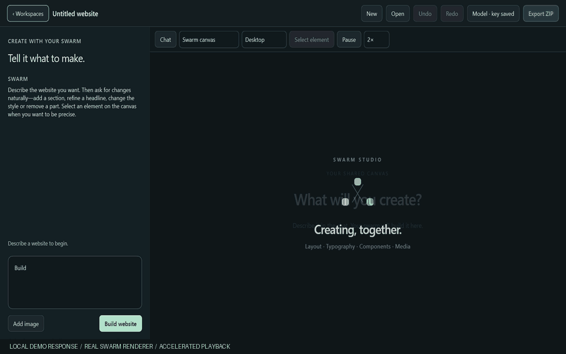
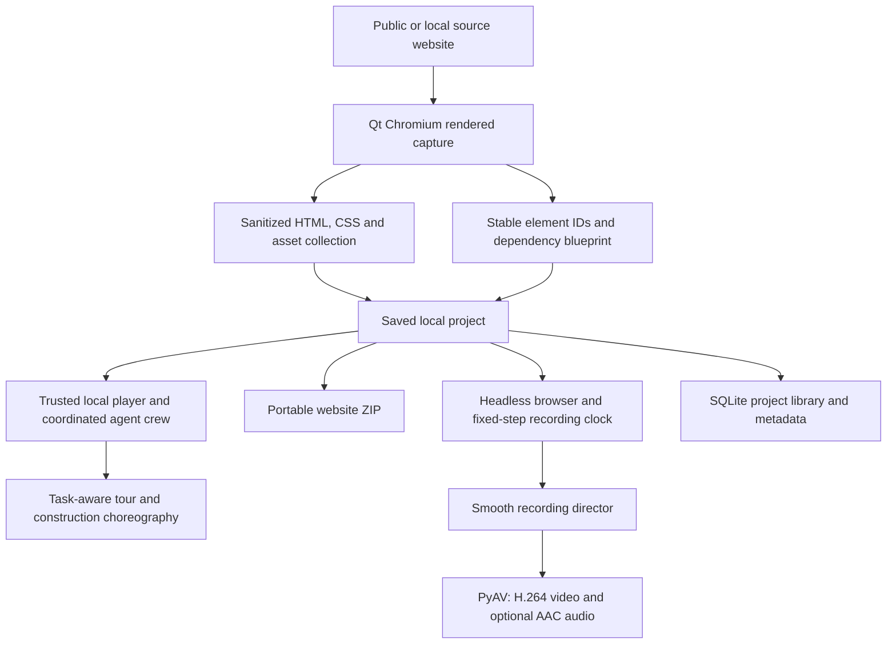

<div align="center">


# SWARM STUDIO AI

### Your website. Your ideas. A whole swarm.

**Rebuild a website. Create from a prompt. Direct your swarm.**

*A desktop website reconstruction and creation studio by Byte by Mint.*

[Download Windows EXE](https://github.com/bytebymint/swarm-studio-ai/releases/latest) · [How it works](#how-it-works) · [Install](#installation) · [Use](#your-first-reconstruction) · [Architecture](#architecture) · [License](#license-and-permissions)

</div>

SWARM STUDIO analyzes a rendered website, maps its structure, styles and assets,
and turns that analysis into a portable local reconstruction. A coordinated crew
of AI-inspired agents brings the page together in front of you: drawing layouts,
typing text, placing images, duplicating components and handing work to one
another as the build progresses.

Choose **Rebuild** or **Create a website** when the app opens.

**Rebuild runs locally without an AI API key.** Capture, task planning,
reconstruction, agent choreography and cinematic video rendering run on your
machine. Export the captured frontend or record its construction as an
automatically directed 1080p film.

**Create uses your Qwen account to write real website code.** Describe your idea,
watch sections appear through the same swarm renderer, then tell it what to add,
change or remove. The app streams validated component changes into the live
canvas instead of replaying a prebuilt template. The native preview, storage and
exports stay local; Qwen inference runs through your configured cloud endpoint
and incurs provider usage charges.

### From an idea to a working frontend



*12-second walkthrough of the real Windows Create workspace: a quick zoom into
 the prompt, then the shared swarm building a four-section SaaS frontend. This
 demo uses an original local response fixture and accelerated playback; no paid
 model request is represented or billed. Real generation speed depends on your
 provider, brief and connection.*

Describe your business. Watch the layout, text and visuals arrive. Select a
headline and ask for a change: only changed elements receive new animation jobs,
while unchanged content stays in place. Add your own images, switch to an
interactive mobile preview, undo an edit, and export a self-contained website.

The shared visual agents are coordinated software personas driven by a task
graph. In Rebuild, those jobs come from the captured DOM. In Create, real model
operations create and update that DOM. Online capture needs access to the source
website; prompt generation needs the model connection. Saved projects and
exported generated websites can be explored offline.

<div align="center">


*10 seconds from a real recording: agents at work, automatic close-ups, smooth transitions.*

</div>

The animation above is an excerpt of the recording supplied for this project.
Third-party site content and branding remain their owners' property; no
affiliation or endorsement is implied. See [third-party notices](THIRD_PARTY_NOTICES.md).

## What you can do

| Capability | What you get |
| --- | --- |
| Create from a prompt | Qwen streams original HTML/CSS/JS sections into the same live swarm visualization. |
| Edit through instructions | Add, remove or change sections; select a precise element, queue instructions and restore earlier revisions. |
| Bring your own images | Upload original images, let Qwen see and place them, and keep them embedded in the export. |
| Analyze a rendered website | DOM structure, readable CSS, computed-style fallback, visual geometry, text, fonts and available media. |
| Rebuild with a coordinated crew | Up to four visible specialists, contextual work cards, inspection/build/review phases and dependency-driven handoffs. |
| Follow the whole page | Automatic tours through document scrolling and nested scrolling containers. |
| Preserve video assets | Downloadable MP4/WebM videos, local posters and controls, dedicated swarm placement and moving content in cinematic movies. |
| Focus on the work | A maximized canvas taking about 90% of the window, with one compact bottom dock. |
| Control the build | Pause, replay, 0.5×–5× speed, stepping, optional sounds and a collapsible timeline. |
| Export the reconstructed website | A ZIP containing captured HTML, CSS, saved images, fonts, assets and project metadata. |
| Compare the result | Original/reconstruction screenshots, an RGB difference heatmap and DOM diagnostics. |
| Record the process | Canvas-only MP4 export at 1080p or 720p, with 60 or 30 frames per second. |
| Receive an automatically directed film | Smooth zoom up to 3× on active edits, pullbacks before section travel, and a wide finish. |
| Reopen work later | A local project library that loads saved reconstructions without recapturing the original site. |

The Rebuild export includes the elements and assets successfully captured within
the configured limits. Source JavaScript, authentication, server logic and
unsupported or inaccessible resources are outside that export. See
[limitations](#limitations) for the boundaries of a reconstruction.

## How it works

1. **Inspect the page you can see.** Chromium renders the source website. The
   capture engine walks the DOM, records visual geometry, reads accessible style
   rules, discovers bounded lazy content and identifies text, images and repeated
   components.
2. **Build a local blueprint.** Stable element IDs connect the saved document to
   a dependency graph. A container's frame can unlock its children before every
   detail finishes; a duplicated component waits for its original to complete.
3. **Save a portable reconstruction.** HTML is sanitized, CSS and resource URLs
   are rewritten, and available assets are stored in the project. Source scripts,
   inline handlers, form values and session storage are excluded.
4. **Let the crew coordinate.** Workers pick eligible, visible tasks according
   to their specialties and distance. Cursors follow the same measured paths as
   the drawing, typing and image work. Unneeded workers fade away.
5. **Explore, compare, export or record.** The result remains a local HTML/CSS
   document. Save the website as a ZIP, inspect comparison reports, or render a
   movie with automatic cinematic camera direction.

The Rebuild workflow above runs locally. Create sends your brief, relevant site
source and uploaded images to your configured model provider. The local preview server binds to `127.0.0.1`; it is an
internal file preview, not a cloud service or a separate development server you
need to start.

## Installation

### Requirements

- **Windows 11, 64-bit.** This is the platform currently packaged and verified.
- **Python 3.12 or newer** to run from source or build an executable.
- **Microsoft Edge or Google Chrome** for recording from source or the folder
  build. The single-file portable build includes a recording browser as a fallback.
  Regular capture and playback use the bundled Qt Chromium engine.
- Enough disk space for the Python/Qt environment, local website assets and
  recordings. A complete packaged distribution is several hundred megabytes.
- Internet access for initial dependency installation and online website capture.
  Rebuild needs no AI provider account or key. Create needs your model connection
  and a provider API key; model usage is billed by the provider.

### Option A — run an existing Windows build

Download **SwarmStudioAI-Portable.exe** from the
[latest GitHub release](https://github.com/bytebymint/swarm-studio-ai/releases/latest).
The release also includes a SHA-256 checksum. The EXE is a Windows x64 build,
not a browser-hosted app.

**Single-file portable build:** double-click **SwarmStudioAI-Portable.exe**.
No installer, Python installation or companion folder is needed. It opens
maximized and includes a recording browser. Copy the one EXE to another supported
Windows 11 x64 computer to run it there. On launch, bundled components extract
automatically into a temporary folder; startup takes longer than the folder build.
Projects and preferences are saved in `%LOCALAPPDATA%\SwarmStudio`, so allow space
for both the extracted runtime and your captures. This is a Windows application;
the EXE does not run natively on macOS, Linux or ARM Windows.

**Folder build:**

1. Extract the entire `SwarmStudio` distribution folder.
2. Keep `SwarmStudio.exe`, `_internal`, `Notices` and the remaining files together.
3. Double-click **SwarmStudio.exe**. The app opens maximized.
4. Optionally run the included `install_windows.ps1` to copy it into your user
   Programs folder and create a Start menu shortcut. Administrator rights are
   not required.

Generated executables are attached to GitHub Releases rather than committed to
Git. Source users can follow Option B. The public build includes **no API key**,
including encrypted bootstrap credentials. Rebuild works without one; choose
**Create → Model** to connect your own Qwen account. Keep your key private.

The EXE is unsigned, so Windows may identify it as an unrecognized application.
Verify its source and the release checksum before deciding whether to run it.
Existing projects and model settings stay in your Windows user profile when you
replace the EXE.

### Option B — run from source with Python

1. Clone the repository, or use **Code → Download ZIP** on
   [GitHub](https://github.com/bytebymint/swarm-studio-ai) and extract it:

   ```powershell
   git clone https://github.com/bytebymint/swarm-studio-ai.git
   Set-Location swarm-studio-ai
   ```

2. Open **PowerShell** in the project folder. Review the
   [personal noncommercial license](LICENSE) before using the software.
3. Confirm that Python 3.12+ is installed:

   ```powershell
   py -3.12 --version
   ```

   These commands target the verified Python 3.12 environment. If you use a newer
   supported Python version, replace the `-3.12` selector with that version.

4. Create an isolated environment:

   ```powershell
   py -3.12 -m venv .venv
   ```

5. Install the verified dependency versions:

   ```powershell
   .\.venv\Scripts\python.exe -m pip install -r requirements-lock.txt
   ```

   To resolve versions within the supported ranges instead, use
   `-r requirements.txt`. No environment activation is required for these commands.

6. Launch the offline demo:

   ```powershell
   .\.venv\Scripts\python.exe main.py --demo
   ```

   Or open the application normally:

   ```powershell
   .\.venv\Scripts\python.exe main.py
   ```

### Alternative — use uv

If you already have `uv` installed, run these commands from the project folder:

```powershell
uv venv --python 3.12 .venv
uv pip install --python .venv/Scripts/python.exe -r requirements-lock.txt
.\.venv\Scripts\python.exe main.py --demo
```

Recording uses your installed Edge or Chrome; a separate Playwright browser
download is not needed when running from source. The first launch may take a
moment while Chromium starts.

### Build a Windows executable

After installing the dependencies:

```powershell
powershell -ExecutionPolicy Bypass -File scripts/build_windows.ps1
```

The build runs the core tests and creates
`dist/SwarmStudio/SwarmStudio.exe`, including WebEngine resources, the offline
demo and third-party notices. Keep that entire folder together. The executable
is unsigned; see [packaging notes](docs/PACKAGING.md) for the verified environment
and the Qt DLL isolation fix.

To build the self-contained, single-file variant instead:

```powershell
powershell -ExecutionPolicy Bypass -File scripts/build_windows.ps1 -Portable
```

This downloads the matching Playwright Chromium headless shell during the build
and embeds it with the app, documentation and dependency notices in
`dist/SwarmStudioAI-Portable.exe`. Building requires internet access; using the
offline demo and recording it do not. Installed Edge/Chrome is preferred for
codec compatibility, with bundled Chromium used when neither can launch.
Find the embedded project license and dependency notices under
**Studio → About and licenses**. The portable EXE is also unsigned.

## Create a website

1. Open the app and choose **Create a website**. **Rebuild** opens the existing
   reconstruction desk; **Workspaces** switches between the two.
2. Open **Model / Add API key** and save your Alibaba Cloud Model Studio key.
   The default model is `qwen3.8-flash` with the international Singapore endpoint.
   If your key belongs to another region or a private deployment, set its
   compatible base URL and model. The workspace-specific endpoints documented by
   Alibaba are supported too. No `.env` file is required.
3. Describe the website: its purpose, audience, sections, visual direction and
   interactions. Use **Add image** for a photo, product image or logo you own or
   have permission to use. Uploaded images are sent to Qwen with the brief.
4. Click **Build website**, or press `Ctrl+Enter`. The model emits complete small
   operations as it writes. The same named crew, cursors, typing, placement,
   dependency handoffs and scrolling camera used by Rebuild visualize those
   actual operations. The renderer does not wait for the whole site to finish.
5. Choose **Interactive preview** to try menus, buttons, accordions and other
   browser behavior. **Swarm canvas** shows the construction; generated scripts
   are kept out of that trusted canvas. Desktop, tablet and mobile viewports are
   available. Agent playback can be paused or changed from 1× to 5×.
6. Use **Select element**, click the part you mean, and type a change. For example:
   “Make this headline shorter,” “Add pricing before the FAQ,” or “Remove the
   testimonials.” Unaffected sections remain intact. Up to three instructions can
   wait in the queue while the current work finishes.
7. **Undo / Redo** restore saved revisions without making another model request.
   Changes, chat instructions and prompt drafts save locally. Interrupted work can
   be recovered when reopening a project. Stop keeps completed changes and
   cancels queued instructions.
8. **Export ZIP** produces an offline-capable static website with its CSS,
   JavaScript, original SVG artwork and embedded uploaded images. It contains no
   provider credential, chat history or app-native code. **Open** reopens your
   locally saved created websites.

Smart review checks desktop/mobile geometry, anchors, images and JavaScript
syntax and asks Qwen for a repair pass. It is not a guarantee of design quality,
accessibility conformance or correct behavior in every browser. The app reports
remaining measured issues instead of claiming universal success. See
[creation architecture and boundaries](docs/CREATION.md).

## Your first reconstruction

1. **Open a website.** Paste an `https://` URL, `http://localhost:PORT` or
   `http://127.0.0.1:PORT` address into the bottom dock, then click **Open**.
   Alternatively, choose **Studio → Try offline demo**.
2. **Prepare the page.** Wait for the layout and images to load. Choose the
   desired viewport under **Studio → Canvas options** before capturing.
3. **Initialize the swarm.** Click **Initialize Swarm**. The app analyzes the
   rendered page, saves its local reconstruction and builds the task graph.
4. **Watch the crew work.** In **Swarm** mode, agents draw, type, place and
   duplicate the captured elements. Keep **Tour** enabled to follow unfinished
   sections automatically.
5. **Adjust playback.** Use **Pause**, **Replay** and the speed selector. Enable
   **Sound** for synthesized agent sounds. The Studio menu provides stepping,
   diagnostics and the optional activity timeline.
6. **Explore the result.** Select **Reconstruction** to use the saved local DOM.
   Native accordions, CSS hover effects, anchors and other preserved browser
   behavior can work; source application scripts and backend services do not.
7. **Compare if needed.** Choose **Studio → Playback → Run comparison** to write
   screenshots, a difference heatmap and DOM checks.
8. **Export or record.** Use **Export** for a portable website ZIP or **Record**
   for an automatically directed movie.

Only capture content you own, have permission to reproduce, or otherwise have a
lawful basis to use. Avoid private accounts, personal information and secrets.

### Export the rebuilt website

1. Complete a capture or reopen a saved project.
2. Click **Export** and choose a ZIP destination.
3. Extract the ZIP into a new folder.
4. Open `index.html` to inspect the saved frontend. For a browser environment
   closer to the app's local preview, serve the extracted folder:

   ```powershell
   py -3.12 -m http.server 8000 --bind 127.0.0.1
   ```

5. Visit `http://127.0.0.1:8000/` in your browser. Press **Ctrl+C** in PowerShell
   when you finish the preview.

The project includes the captured document, reconstructed CSS, successfully saved
assets and metadata. Exporting does not restore a site's server, proprietary
scripts, protected content or missing resources. Export warnings identify capture
and asset limits. Rights in the website remain with their owners.

### Record an automatically edited cinematic video

1. Open a saved project or initialize a new swarm.
2. Click **Record** in the bottom dock or **Studio → Cinematic recording**.
3. Choose **1080p · 1920 × 1080** and **60 fps** for the default high-quality
   output; 720p and 30 fps are also available.
4. Select a camera cap of **3×**, **2×** or **Wide view**. Choose build speed and
   whether to include agent sounds.
5. Click **Save MP4…** and choose the destination.
6. Wait for the background render to finish, then click **Play video**.

The director chooses active edits, eases into close-ups, briefly gives the
selected work time to read, pulls back before section travel and finishes wide.
The saved MP4 contains the canvas, with optional synchronized synthesized audio.
It does not record the app toolbar, desktop, microphone or unrelated windows.

This is a deterministic movie render rather than a real-time desktop recorder:
every output frame is rendered individually. A busy desktop therefore does not
drop movie frames, although rendering can take longer than playback. The camera
editing is automatic; there is no manual video editor or timeline of editable
camera cuts in this release. Movies are bounded to ten minutes.

### Video assets

Direct, unauthenticated **MP4 and WebM** video sources are captured from video
elements, nested sources, supported lazy attributes and accessible shadow roots.
Saved media lives in `assets/media/` and is included in website ZIP exports.
Videos receive dedicated `place_media` tasks using the existing cursor/reveal
choreography. Supported videos remain playable when the source site is offline.

**Studio → Settings → Media** controls the per-video limit (64 MB by default)
and total video budget (256 MB per captured page). Downloads stream to disk,
validate containers/codecs and honor cancellation and existing capture deadlines.

Cinematic rendering seeks paused source videos on the movie clock, preserving
looping and playback rate while retaining 720p/1080p and 30/60 fps output. Source
video audio is not mixed into the synthesized agent sounds. Encoding can be
slower than real time. Codec support depends on the installed browser.

HLS/DASH, DRM, MSE/blob streams, authenticated or signed sources, embedded players,
unsupported codecs and over-budget media use an available authorized poster or
a marked placeholder, with warnings. A preserved poster is not reported as a
successfully reconstructed playable video. See [video behavior and security](docs/VIDEO.md).

**Studio → Video sources** shows whether detected media is same-origin or
third-party, plus its provider, capture status and source/embed link. YouTube
heroes retain a clean embed/watch link and an explicitly labeled thumbnail
fallback; they are not downloaded as offline video files.

### Capture more than one page

Under **Studio → Settings → Capture**, increase the same-origin page limit from
the default **1** to **2–8** and choose link depth **0–2**. The crawler follows
eligible discovered links on the same origin, saves captured pages and rewrites
their local links. Common login, account, checkout and destructive paths are
excluded. Animation and cinematic recording cover the first captured page.

### Saved projects and shortcuts

Projects, settings and the SQLite library live under
`%LOCALAPPDATA%\SwarmStudio`. Use **Studio → Open saved project** to reopen work
without loading the original source. To keep a separate local library:

```powershell
.\.venv\Scripts\python.exe main.py --data-dir "D:\SwarmStudioData"
```

| Shortcut | Action |
| --- | --- |
| `Ctrl+L` | Focus the website address. |
| `Ctrl+N` | Start a new project. |
| `Ctrl+O` | Open a saved project. |
| `Ctrl+E` | Export the reconstructed website. |
| `F11` | Toggle fullscreen presentation. |

## Agent skills and coordination

The default roster contains eight named workers. The scheduler activates only
the workers needed for visible tasks; the roster is not a cloud of idle cursors.
At most four workers build at once. Available specialists own their matching
operations; smaller rosters fall back to another worker when a specialty is
absent. Each task has a brief inspection, its actual construction and a review
hold. Work cards show the worker, specialty, current target and progress, with
stable placement and a constant readable size during cinematic zooms. These
labels describe the captured task graph; they are not generated model thoughts.

| Agent | Specialty |
| --- | --- |
| Ada | Layout and frame construction. |
| Grace | Typography and text work. |
| Linus | Repeated components and duplication. |
| Hedy | Images and asset placement. |
| Alan | Inspection and verification. |
| Radia | Navigation and related text/layout work. |
| Margaret | Larger structural frames. |
| Ken | Fine details and paths. |

The core skills are drawing, typing, placing, duplicating, stroking and verifying.
Parent-frame milestones unlock dependent work; completed master components
unlock duplication. Published events drive the timeline and diagnostics. Cursor
position and visible work share one trajectory, so the mouse stays attached to
the job. Text uses browser ranges and Custom Highlights to preserve line layout.

These skills are implemented in the application itself. Running the app does not
require an agent marketplace, an external coding-agent skill or a paid AI service.

## Architecture



| System | Implementation |
| --- | --- |
| Desktop application | Python, PySide6 native widgets, Qt WebEngine and WebChannel. |
| Capture and planning | Isolated JavaScript DOM inspection, stable IDs and a dependency graph. |
| Local reconstruction | Beautiful Soup/lxml sanitization, HTTPX asset collection and CSS URL rewriting. |
| Agent motion | Independently implemented JavaScript, Canvas 2D, DOM Range and Custom Highlights. |
| Scrolling camera | Task-driven document/nested tours with eased motion and section holds. |
| Project storage | SQLite library, JSON metadata and portable directories. |
| Local preview | GET/HEAD-only loopback HTTP server. |
| Cinematic recording | Playwright, Edge/Chrome or portable bundled Chromium, CDP compositor frames and a deterministic clock. |
| Media encoding | PyAV/FFmpeg H.264, optional AAC, NumPy audio synthesis and Pillow frame handling. |
| Verification | pytest, independent browser checks, native UI checks and decoded-movie checks. |
| Windows packaging | PyInstaller single-file portable EXE or folder distribution, dependency notices and an optional current-user installation script. |

The source browser never receives the native WebChannel. Only the trusted local
player receives its bounded event bridge. The capture profile is memory-only;
cookies, browser storage and source scripts are not exported. Website loading
still makes ordinary network requests, and asset downloads occur locally within
configured budgets. See [the architecture document](docs/ARCHITECTURE.md).

### Repository layout

```text
app/                    Native UI, capture orchestration, reconstruction and storage
web/                    Capture, player, crew, choreography, cameras and offline demo
assets/                 Original application icons
scripts/                Build, launch, diagnostics, media and integration checks
tests/                  Core automated tests
docs/                   Architecture, provenance, packaging and verification
docs/media/             The README's ten-second cinematic demonstration
main.py                 Desktop entry point
SwarmStudio.spec        Windows packaging specification
LICENSE                 Personal noncommercial use terms
THIRD_PARTY_NOTICES.md   Dependency and third-party content boundaries
```

## Limitations

- **A frontend reconstruction, not a universal website compiler.** Source
  JavaScript, authentication, private APIs, databases and backend behavior are
  excluded. A visually faithful result is not proof of functional equivalence.
- **No autonomous LLM code generation.** Agent actions are a locally scheduled
  visualization of the captured task graph. They do not call an AI model or
  independently reason about a new product specification.
- **Capture is bounded.** Element counts, document height, lazy discovery,
  timeouts and asset budgets can limit the result. Infinite feeds and every
  possible hidden state are not exhaustively captured.
- **Some resources cannot be reproduced.** Protected, signed, unavailable,
  cross-origin or over-budget assets may be skipped. Cross-origin frames become
  placeholders; canvas may become an image. Closed shadow roots, WebGL, DRM and
  live streams are unsupported. Direct MP4/WebM videos are supported within
  media budgets and browser codec capabilities; other videos use explicit fallbacks.
- **Responsive behavior can differ.** The captured viewport is the primary
  fidelity target. Computed fallbacks, inaccessible CSS, platform fonts, complex
  shadow styling and dynamic CSS can change other layouts or states.
- **Forms and sessions are intentionally restricted.** Existing form values,
  hidden inputs, inline handlers and session storage are removed. Exported forms
  cannot submit to the source site's backend.
- **Comparisons are measurements, not guarantees.** RGB differences and geometry
  checks cover a viewport. They do not prove semantics, accessibility, behavior
  or backend equivalence. Occluded native views may retain stale screenshots.
- **Performance depends on the project.** Large DOMs and backward resimulation
  can take time. Interactive playback has no universal FPS guarantee. Movie
  exports have a fixed frame rate but can render slower than real time.
- **The recorded movie has scope limits.** It uses the first saved page, pauses
  decorative source animations, uses Edge/Chrome or portable bundled Chromium and has a
  ten-minute cap. Its camera is automatically directed rather than manually edited.
- **Windows is the verified platform.** Other operating systems, a signed
  installer and clean second-machine validation remain outside the current
  release verification.

## Verification and development

Run the core tests from PowerShell:

```powershell
New-Item -ItemType Directory -Path test-results -Force | Out-Null
.\.venv\Scripts\python.exe -m pytest -q --basetemp=test-results/unit-run
```

Additional checks exercise actual Chromium pages, native windows and movie files:

```powershell
.\.venv\Scripts\python.exe scripts/test_browser.py
.\.venv\Scripts\python.exe scripts/test_camera.py
.\.venv\Scripts\python.exe scripts/test_crew.py
.\.venv\Scripts\python.exe scripts/test_focus_layout.py
.\.venv\Scripts\python.exe scripts/test_recording.py
.\.venv\Scripts\python.exe scripts/test_recording_hd.py
```

Run `test_recording.py` before `test_recording_hd.py`; the HD check uses its saved
fixture. Some checks use installed Chrome, and the recording check uses installed
Edge. Native checks open real windows. Public-site and isolated-reference checks
have additional network/reference prerequisites documented in their scripts.

For unattended native checks behind other windows, set the following only for
the test process to reduce Chromium background throttling:

```powershell
$env:QTWEBENGINE_CHROMIUM_FLAGS='--disable-background-timer-throttling --disable-renderer-backgrounding --disable-backgrounding-occluded-windows'
```

The verified demo movie completed all **66 tasks**, produced **1,619 frames at
1920 × 1080 / 60 fps**, and decoded with the exact expected frame count and
monotonic timestamps. The Windows executable also completed a real MP4 export.
Those results describe the tested fixture, not every possible website. Detailed
evidence is documented in [verification](docs/VERIFICATION.md).

To recreate the README GIF from a recording you are authorized to use:

```powershell
.\.venv\Scripts\python.exe scripts/make_readme_gif.py --input "C:\path\to\recording.mp4" --start 38 --duration 10 --fps 20 --width 800 --colors 128
```

## License and permissions

Copyright © 2026 **Byte by Mint**. All rights reserved.

SWARM STUDIO uses a custom **Personal Noncommercial Use License**. You may
inspect, run and privately modify it for personal, noncommercial learning and
evaluation. Only working and backup copies necessary for that permitted use are
allowed. Redistribution, copying into another distributed project, selling,
paid client work and other commercial use require **prior written approval**.
This is restricted source-available software, not an open-source license.

Read [LICENSE](LICENSE) for the actual terms. Third-party libraries retain their
own licenses; see [THIRD_PARTY_NOTICES.md](THIRD_PARTY_NOTICES.md). This license
does not grant rights in websites or content you capture.

**Commercial licensing, redistribution and permission requests:**
[info@bytebymint.space](mailto:info@bytebymint.space).

## Responsible use and disclaimer

Use SWARM STUDIO only on material you own, are authorized to reproduce, or have
another lawful basis to use. A publicly accessible website is not automatically
free to copy. Designs, code, text, photographs, fonts, trademarks and recordings
may carry separate rights and restrictions.

You are responsible for obtaining necessary permissions and for the legality of
your captures, reconstructions, exports, recordings and publication. SWARM STUDIO
does not grant third-party rights, bypass access controls or establish that a
use qualifies for a legal exception. Do not use it for impersonation, phishing,
unauthorized commercial copying or privacy violations.

The software is provided **as is**, without warranties. To the maximum extent
permitted by applicable law, Byte by Mint and the contributors disclaim liability
for misuse, unauthorized website reproduction, intellectual-property claims or
other losses arising from the software or its output. Nothing here excludes
liability that applicable law does not permit to be excluded. The full terms are
in [LICENSE](LICENSE).

For copyright background in the UAE, see the
[UAE Government's intellectual property guidance](https://u.ae/en/information-and-services/business/intellectual-property).
This reference is informational and does not imply government affiliation,
copyright registration or approval of this project.

For project permissions or concerns, email
[info@bytebymint.space](mailto:info@bytebymint.space).

## Provenance

The desktop implementation is independent. Separately supplied reference
materials are excluded from the repository and packaged application; see
[reference provenance](docs/REFERENCE.md). The initial local commit history was
reconstructed from the working project with assigned dates at the owner's
request; see [history provenance](docs/HISTORY.md).
