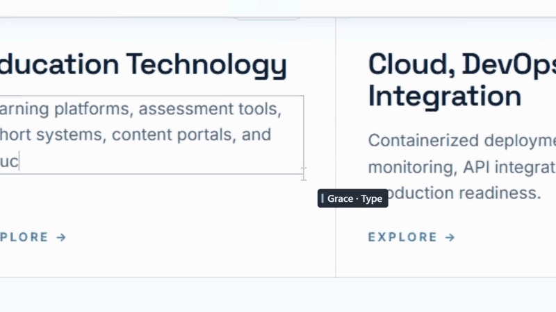

<div align="center">


# SWARM STUDIO

### Analyze a website. Unleash a local swarm. Watch the rebuild.

**A cinematic website reconstruction studio by Byte by Mint.**

[How it works](#how-it-works) · [Install](#installation) · [Use](#your-first-reconstruction) · [Architecture](#architecture) · [License](#license-and-permissions)

</div>

SWARM STUDIO analyzes a rendered website, maps its structure, styles and assets,
and turns that analysis into a portable local reconstruction. A coordinated crew
of AI-inspired agents brings the page together in front of you: drawing layouts,
typing text, placing images, duplicating components and handing work to one
another as the build progresses.

**No expensive AI API subscriptions. No cloud inference. No API keys.** Capture,
task planning, reconstruction, agent choreography and video rendering run on your
machine. Export the captured frontend as a website project, or turn the entire
build into an automatically directed cinematic 1080p video.

The current agent system is deterministic and rule based: these are coordinated
software personas driven by a real task graph, not LLMs independently writing
code. Internet access is needed to load online source websites and download
available assets; the bundled demo and saved local projects work offline.

<div align="center">



*10 seconds from a real recording: agents at work, automatic close-ups, smooth transitions.*

</div>

The animation above is an excerpt of the recording supplied for this project.
Third-party site content and branding remain their owners' property; no
affiliation or endorsement is implied. See [third-party notices](THIRD_PARTY_NOTICES.md).

## What you can do

| Capability | What you get |
| --- | --- |
| Analyze a rendered website | DOM structure, readable CSS, computed-style fallback, visual geometry, text, fonts and available media. |
| Rebuild with a coordinated crew | Visible workers assigned real construction tasks, with dependencies and genuine task handoffs. |
| Follow the whole page | Automatic tours through document scrolling and nested scrolling containers. |
| Focus on the work | A maximized canvas taking about 90% of the window, with one compact bottom dock. |
| Control the build | Pause, replay, 0.5×–5× speed, stepping, optional sounds and a collapsible timeline. |
| Export the reconstructed website | A ZIP containing captured HTML, CSS, saved images, fonts, assets and project metadata. |
| Compare the result | Original/reconstruction screenshots, an RGB difference heatmap and DOM diagnostics. |
| Record the process | Canvas-only MP4 export at 1080p or 720p, with 60 or 30 frames per second. |
| Receive an automatically directed film | Smooth zoom up to 3× on active edits, pullbacks before section travel, and a wide finish. |
| Reopen work later | A local project library that loads saved reconstructions without recapturing the original site. |

The website export includes the elements and assets successfully captured within
the configured limits. Source JavaScript, authentication, server logic and
unsupported or inaccessible resources are outside that export. See
[limitations](#limitations) for the boundaries of a reconstruction.

## How it works

1. **Inspect the page you can see.** Chromium renders the source website. The
   capture engine walks the DOM, records visual geometry, reads accessible style
   rules, discovers bounded lazy content and identifies text, images and repeated
   components.
2. **Build a local blueprint.** Stable element IDs connect the saved document to
   a dependency graph. A container's frame can unlock its children before every
   detail finishes; a duplicated component waits for its original to complete.
3. **Save a portable reconstruction.** HTML is sanitized, CSS and resource URLs
   are rewritten, and available assets are stored in the project. Source scripts,
   inline handlers, form values and session storage are excluded.
4. **Let the crew coordinate.** Workers pick eligible, visible tasks according
   to their specialties and distance. Cursors follow the same measured paths as
   the drawing, typing and image work. Unneeded workers fade away.
5. **Explore, compare, export or record.** The result remains a local HTML/CSS
   document. Save the website as a ZIP, inspect comparison reports, or render a
   movie with automatic cinematic camera direction.

All of this runs locally. The local preview server binds to `127.0.0.1`; it is an
internal file preview, not a cloud service or a separate development server you
need to start.

## Installation

### Requirements

- **Windows 11, 64-bit.** This is the platform currently packaged and verified.
- **Python 3.12 or newer** to run from source or build an executable.
- **Microsoft Edge or Google Chrome** installed if you want cinematic recording.
  Regular capture and playback use the bundled Qt Chromium engine.
- Enough disk space for the Python/Qt environment, local website assets and
  recordings. A complete packaged distribution is several hundred megabytes.
- Internet access for initial dependency installation and online website capture.
  No AI provider account or API key is required.

### Option A — run an existing Windows build

If you have been provided a complete, authorized distribution:

1. Extract the entire `SwarmStudio` distribution folder.
2. Keep `SwarmStudio.exe`, `_internal`, `Notices` and the remaining files together.
3. Double-click **SwarmStudio.exe**. The app opens maximized.
4. Optionally run the included `install_windows.ps1` to copy it into your user
   Programs folder and create a Start menu shortcut. Administrator rights are
   not required.

This repository keeps generated builds out of Git. If you only have source
files, follow Option B. There is no public binary download implied by this guide.

### Option B — run from source with Python

1. Obtain an authorized copy of the source and extract it.
2. Open **PowerShell** in the extracted project folder.
3. Confirm that Python 3.12+ is installed:

   ```powershell
   py -3.12 --version
   ```

4. Create an isolated environment:

   ```powershell
   py -3.12 -m venv .venv
   ```

5. Install the verified dependency versions:

   ```powershell
   .\.venv\Scripts\python.exe -m pip install -r requirements-lock.txt
   ```

   To resolve versions within the supported ranges instead, use
   `-r requirements.txt`. No environment activation is required for these commands.

6. Launch the offline demo:

   ```powershell
   .\.venv\Scripts\python.exe main.py --demo
   ```

   Or open the application normally:

   ```powershell
   .\.venv\Scripts\python.exe main.py
   ```

### Alternative — use uv

If you already have `uv` installed, run these commands from the project folder:

```powershell
uv venv --python 3.12 .venv
uv pip install --python .venv/Scripts/python.exe -r requirements-lock.txt
.\.venv\Scripts\python.exe main.py --demo
```

Recording uses your installed Edge or Chrome; a separate Playwright browser
download is not needed. The first launch may take a moment while Chromium starts.

### Build a Windows executable

After installing the dependencies:

```powershell
powershell -ExecutionPolicy Bypass -File scripts/build_windows.ps1
```

The build runs the core tests and creates
`dist/SwarmStudio/SwarmStudio.exe`, including WebEngine resources, the offline
demo and third-party notices. Keep that entire folder together. The executable
is unsigned; see [packaging notes](docs/PACKAGING.md) for the verified environment
and the Qt DLL isolation fix.

## Your first reconstruction

1. **Open a website.** Paste an `https://` URL, `http://localhost:PORT` or
   `http://127.0.0.1:PORT` address into the bottom dock, then click **Open**.
   Alternatively, choose **Studio → Try offline demo**.
2. **Prepare the page.** Wait for the layout and images to load. Choose the
   desired viewport under **Studio → Canvas options** before capturing.
3. **Initialize the swarm.** Click **Initialize Swarm**. The app analyzes the
   rendered page, saves its local reconstruction and builds the task graph.
4. **Watch the crew work.** In **Swarm** mode, agents draw, type, place and
   duplicate the captured elements. Keep **Tour** enabled to follow unfinished
   sections automatically.
5. **Adjust playback.** Use **Pause**, **Replay** and the speed selector. Enable
   **Sound** for synthesized agent sounds. The Studio menu provides stepping,
   diagnostics and the optional activity timeline.
6. **Explore the result.** Select **Reconstruction** to use the saved local DOM.
   Native accordions, CSS hover effects, anchors and other preserved browser
   behavior can work; source application scripts and backend services do not.
7. **Compare if needed.** Choose **Studio → Playback → Run comparison** to write
   screenshots, a difference heatmap and DOM checks.
8. **Export or record.** Use **Export** for a portable website ZIP or **Record**
   for an automatically directed movie.

Only capture content you own, have permission to reproduce, or otherwise have a
lawful basis to use. Avoid private accounts, personal information and secrets.

### Export the rebuilt website

1. Complete a capture or reopen a saved project.
2. Click **Export** and choose a ZIP destination.
3. Extract the ZIP into a new folder.
4. Open `index.html` to inspect the saved frontend. For a browser environment
   closer to the app's local preview, serve the extracted folder:

   ```powershell
   py -3.12 -m http.server 8000 --bind 127.0.0.1
   ```

5. Visit `http://127.0.0.1:8000/` in your browser. Press **Ctrl+C** in PowerShell
   when you finish the preview.

The project includes the captured document, reconstructed CSS, successfully saved
assets and metadata. Exporting does not restore a site's server, proprietary
scripts, protected content or missing resources. Export warnings identify capture
and asset limits. Rights in the website remain with their owners.

